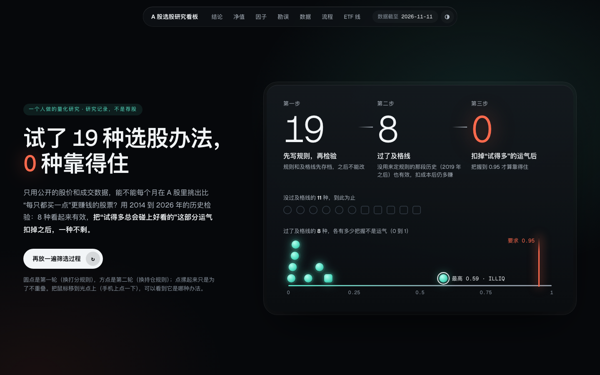
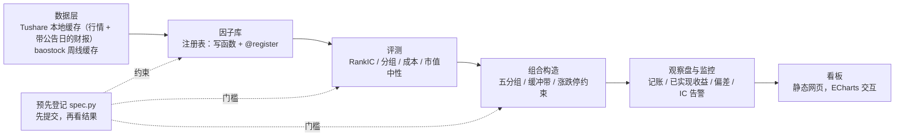

# quant-allocation-research：跨市场 ETF 配置研究

[](https://github.com/kennywu411-dev/quant-allocation-research/actions/workflows/ci.yml)

个人跨市场（A股 + 美股）ETF 配置研究系统，用 Python 自建：数据清洗、回测引擎、预登记选参、样本外检验、A股单因子检验与全 A 股因子研究平台（因子库、一键体检、月度流水线、看板），以及影子盘、模拟盘的执行偏差监控。

> **声明**：这是个人研究记录，不是投资建议。所有收益和回撤都来自历史回测，不代表未来。作者不是持牌金融顾问。

[](https://kennywu411-dev.github.io/quant-allocation-research/dashboard/)

**在线看板：<https://kennywu411-dev.github.io/quant-allocation-research/dashboard/>**（点上图也能打开；怎么读见 [docs/看板导读.md](docs/看板导读.md)）。上图是首屏：一句结论和一张 19 → 8 → 0 的筛选图，每个点是一次试验，可以重播、可以点开看数字。页面只有一套内容，每张图上方有一句“这张图在说什么”，术语在第一次用到它的图下面就地解释，不懂量化也能读。往下是“19 根柱子，没有一根碰到红线”（每种办法的名字和把握）、及格线图、完整数字表、净值与水下回撤（可按时间段刷选）、月度超额热力图、五分组、逐月 RankIC、换手与成本、勘误前后对照、数据层覆盖和 ETF 配置线回测。版式参考了 QuantStats、pyfolio、Alphalens、Qlib、Grafana 等开源项目的报告（只借鉴思路，见导读）。页面是静态网页，没有实时行情；数字都由 `quant/alpha/dashboard.py` 从 `research/` 下的结果文件读出，图表库 ECharts 5.6.0（Apache-2.0）和字体 Geist、Geist Mono（SIL OFL 1.1，许可证在 `reports/看板/fonts/OFL.txt`）随仓库一起托管，不请求外部网络。

## 主要结论

| 内容 | 结果 | 出处 |
|---|---|---|
| 回测引擎校准 | 和开源库 bt 交叉核对，年化与最大回撤差均为 0.00 个百分点 | `reports/P2-回测校准-2026-10-30.md` |
| 核心配置（美股 60% 标普500，A股 30% 沪深300 + 红利，其余债券和黄金，10 个月均线转国债；2007-06 至 2026-10，人民币计） | 年化 5.9%，样本内（至 2019）6.0%，样本外（2020 起）5.8%；三种调仓日中最差的最大回撤 -14.2% | `reports/P5-最终方案-2026-10-31.md` |
| 5 个因子 ETF 卫星候选 | 全部否决。例如红利低波的 alpha t = 3.12，但按试验次数折扣后，通缩夏普只有 0.85（门槛 0.95） | `reports/P4-卫星-2026-11-04.md` |
| 幸存者偏差估计 | 用今天的成分股回测动量个股组合，比含退市股的 French 组合每年高 25.0 个百分点 | `reports/动量个股检验-2026-11-04.md` |
| A股单因子检验（7 个因子，今天的沪深300 成分股，2010–2026） | 按运行前固定的门槛（t ≥ 3 且样本外同号）全部不显著，最高为 12-1 动量（t = 1.88） | `reports/因子检验-2026-11-10.md` |
| 大模型读公告（Claude Haiku 结构化标注沪深300 成分股 27.4 万条公告标题，2020–2026） | 判定标准在标注前提交。主假设（模型知识截止后的干净样本、持有 5 天、实质性利好减利空）未通过：-0.35%，t = -0.96；用两个知识截止日不同的模型在同一时段对照，前视增益不显著（t = 0.93）。总花费 7.65 美元 | `reports/公告因子-2026-11-11.md` |
| 全 A 股因子挖掘（含退市股 5,481 只，2014–2026，周线；10 个因子 + 等权 / IC 加权 / LightGBM 合成） | 门槛在下载数据前提交：13 个试验通过 7 个（其中 3 个擦线；低特质波动 RankIC 0.091，t = 8.05）。10 个 RankIC 显著，但按 13 次试验折扣后通缩夏普最高 0.59，全部低于 0.95，纯多头超额不能确认显著；LightGBM 相对等权线性合成没有样本外增益（t = -0.13） | `reports/因子挖掘-2026-11-12.md` |
| 因子挖掘第二轮：只改持仓构造（慢因子合成、缓冲带、市值中性、剔除最差组） | 6 个试验通过 1 个：慢因子合成 + 缓冲带，年化超额 +5.8%，Newey-West t = 3.05（门槛 3），月换手 10%；通缩夏普 0.15，没有任何组合达到“影子盘候选”标准（≥ 0.95）。市值中性后等权合成样本外超额 +1.9%（t = 0.64） | `reports/因子挖掘勘误-2026-11-12.md` |
| 勘误（2026-11-12） | 搭因子库框架时发现组合模拟的持有月份标签重复，153 个调仓日里丢了 19 个持有期。失败测试和修正先提交，再按原登记重跑：第一轮通过数 4 → 7，第二轮 0 → 1，RankIC 不变，通缩夏普的结论不变。修正前的报告和结果保留 | `reports/因子挖掘勘误-2026-11-12.md` |

## 因子研究平台



- **数据层**（`quant/tsdata/`）：Tushare Pro 下载器，按交易日和报告期分片存成本地 parquet，原子写入、断点续传、限速、失败重试、自动翻页。本地缓存 8 类数据共 46,882,953 行（日线、复权因子、每日指标、每日 ST 名单 2010-01-04 起；三大报表和业绩预告 2009 年一季报起，三大报表每行带公告日和实际公告日），统计见 `research/tsdata_coverage.json`。数据本身和 token 不在仓库里；测试全部离线。没做的：343 只已退市股票里 68 只在缓存区间内没有日线，原因没有逐只核对；财报更正记录是否齐全没有抽查；还没有基于这批财报数据的因子结果，上面两轮试验用的是 baostock 周线缓存。
- **新增因子**只要在 `quant/alpha/library.py` 写一个函数并登记；名字不在 `quant/alpha/spec.py` 预先登记名单里的因子，体检命令会拒绝对真实数据出结果。
- **一键体检**（`quant/alpha/checkup.py`）：RankIC 与 t、五分组、换手与成本、纯多头超额、市值中性；行业中性因为没有行业数据，报告里写“未做”。样例见 `reports/因子体检/`。
- **月度流水线**（`quant/alpha/pipeline.py`）：默认由 Tushare 日线合成周线（`quant/alpha/ts_weekly.py`，也可改回 baostock 周线缓存）→ 算因子 → 目标持仓 → 追加观察盘记录 → 上期已实现收益 → 偏差与因子衰减监控。观察盘只记账、不下单，记录不公开；目前只有一期，还没有已实现收益。
- **看板**（`quant/alpha/dashboard.py`，模板 `quant/alpha/dashboard.html`）：[在线版](https://kennywu411-dev.github.io/quant-allocation-research/dashboard/)，仓库里的文件是 `dashboard/index.html` 和 `reports/看板/因子看板-公开版.html`（内容相同）。19 次试验的清单与门槛图（点一行联动其余图表）、净值与水下回撤、月度与分年超额、逐月 RankIC、五分组、换手与成本、勘误前后对照、数据层覆盖、ETF 配置线回测；公开版由白名单生成，不含持仓、观察盘记录和任何账户信息。
- 回归测试保证框架复现结果文件里的数字。详见 `docs/因子线架构.md`。
- 报告里出现的提交号（如 `db2d90b`、`6c406f7`）来自未公开的开发仓库，用来说明“登记先于结果”的先后顺序。

## 趋势过滤的代价（基准对比）

口径与 P5 报告一致（两账户合并、人民币计、2007-06 至 2026-10，最大回撤取三种调仓日中最差的）。脚本 `quant/research/benchmarks.py`，结果 `research/p5_benchmarks.json`。

| 指标 | 核心配置（加 10 个月均线） | 同权重、不加均线 | 纯股票（SPY / 沪深300） |
|---|---:|---:|---:|
| 全期年化 | 5.9% | 7.3% | 7.3% |
| 样本外年化（2020 起） | 5.7% | 9.3% | 10.5% |
| 最差最大回撤 | -14.2% | -32.0% | -61.0% |
| 年化波动 | 8.3% | 9.6% | 16.7% |
| 夏普 | 0.39 | 0.49 | 0.33 |
| 卡玛 | 0.41 | 0.23 | 0.12 |

趋势过滤把最大回撤从 -32.0% 降到 -14.2%（主要是 2008 年：2.8% 对 -19.0%），代价是年化 5.9% 对 7.3%、夏普 0.39 对 0.49；2022 年股债同跌时反而更差（-10.1% 对 -4.0%）。它是回撤保险，不是收益来源。

## 防过拟合的做法

- **试验登记**：每次试验追加一行到 `research/trials.csv`，带运行编号（`quant/research/registry.py`）。
- **样本切分**：2019-12-31 以前是样本内，用于排名；2020 年以后是样本外，只检验，不参与选择。
- **门槛在运行前写进代码**（`quant/research/gates.py`）：样本外为正且不低于样本内一半、成本翻倍仍盈利、换调仓日的年化差 ≤ 2 个百分点、去掉最好的一年仍盈利。
- **统计检验**：Newey-West 调整的 alpha t 值、通缩夏普比率（`quant/research/stats.py`）；风控规则用平稳分块自助法比较（`quant/research/riskrule.py`）。

## 目录

```
quant/
  data/        行情下载与缓存（AKShare、yfinance 等免费源），ETF 份额拆分修正
  backtest/    月度调仓回测引擎（涨跌停、停牌、整手、成本、汇率）、与 bt 交叉核对
  research/    P3 核心配置、P4 卫星、P5 组合与风控、激进版研究、统计检验
  factors/     A股单因子检验（数据、因子、IC / 分组 / 成本）
  alpha/       全 A 股因子研究：预先登记、因子注册表、一键体检、组合模拟（涨跌停约束）、合成（等权 / IC 加权 / LightGBM）、
               持仓构造（缓冲带等）、观察盘、月度流水线、看板
  tsdata/      Tushare Pro 数据层：限速客户端、下载器（断点续传）、本地 parquet 缓存
  llm_events/  大模型读公告：巨潮公告下载、结构化标注（Batch API、缓存、预算上限）、事件研究与月度情绪因子
  live/        月度调仓单、份额净值账本、影子盘、模拟盘（只允许 SIMULATE）、偏差报告
  portfolio/   持仓体检与过渡方案
reports/       各阶段研究报告
research/      试验登记表与结果数据
tests/         单元测试
```

## 运行

```bash
python3.12 -m venv .venv && .venv/bin/pip install pandas numpy pyarrow yfinance akshare baostock tushare matplotlib bt moomoo-api anthropic lightgbm pytest
.venv/bin/pytest -q
```

本仓库的测试不联网、不需要任何 token 和本地数据：2026-11-12 本地运行 `pytest -q` 的输出是 `275 passed, 3 skipped`（跳过的 3 个需要本地数据缓存）。

A股单因子检验（单线程下载，约 70 分钟）：

```bash
PYTHONPATH=. .venv/bin/python -m quant.factors.data_current
PYTHONPATH=. .venv/bin/python -m quant.factors.run --source current
```

大模型读公告（需要 `ANTHROPIC_API_KEY`；下载约 2 小时，标注用 Batch API）：

```bash
PYTHONPATH=. .venv/bin/python -m quant.llm_events.data
PYTHONPATH=. .venv/bin/python -m quant.llm_events.label --model claude-haiku-5-5
PYTHONPATH=. .venv/bin/python -m quant.llm_events.label --model claude-haiku-4-5 --start 2025-08-01
PYTHONPATH=. .venv/bin/python -m quant.llm_events.label --review 200
PYTHONPATH=. .venv/bin/python -m quant.llm_events.run
```

全 A 股因子挖掘（baostock 单进程；周线下载约 4 小时）：

```bash
PYTHONPATH=. .venv/bin/python -m quant.alpha.data  # 只用于生成股票名单：打印“A股并集 N 只”后即可停止（之后是日线下载）
PYTHONPATH=. .venv/bin/python -m quant.alpha.weekly_data
PYTHONPATH=. .venv/bin/python -m quant.alpha.weekly
PYTHONPATH=. .venv/bin/python -W ignore -m quant.alpha.round2      # 第二轮：持仓构造
PYTHONPATH=. .venv/bin/python -W ignore -m quant.alpha.checkup --all  # 因子体检
PYTHONPATH=. .venv/bin/python -W ignore -m quant.alpha.pipeline --source cache  # 月度流水线，用 baostock 周线缓存（会写 live/alpha_shadow/）
PYTHONPATH=. .venv/bin/python -W ignore -m quant.alpha.dashboard   # 看板
```

Tushare 数据层（需要自己的 Tushare Pro 账号，token 放在环境变量 `TUSHARE_TOKEN`；全量下载一次实测约 67 分钟）：

```bash
PYTHONPATH=. .venv/bin/python -m quant.tsdata.download              # 下载或增量更新，已有分片跳过
PYTHONPATH=. .venv/bin/python -m quant.alpha.ts_weekly --coverage   # 统计缓存行数 → research/tsdata_coverage.json
PYTHONPATH=. .venv/bin/python -W ignore -m quant.alpha.pipeline     # 月度流水线，默认用 Tushare 数据
```

## 不在仓库里的输入

- `data/cache/`：所有下载的行情和财报缓存（已 gitignore）；Tushare token 只从环境变量读，不写进代码、日志或缓存。

- `config/holdings.csv`：真实持仓，不公开。格式见 `config/holdings.example.csv`。持仓体检、过渡方案和实盘对照都要用它。
- 两个账户合并回测用的账户市值比例不公开：`trials.csv` 和 `research/*.json` 里已删掉这一列，报告里也删掉了具体比例。合并类的命令需要自己用 `--w-us` 传入。
- moomoo 模拟账户号：用环境变量 `MOOMOO_PAPER_ACC_ID` 提供，或写进 `config/moomoo_paper_acc_id.txt`（已 gitignore）。
- `live/`：真实调仓单、影子盘和模拟盘记录，不公开。

## 许可证

MIT，见 `LICENSE`。
