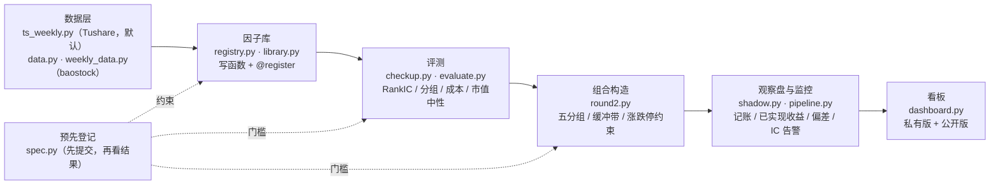

# 选股因子线架构

> 研究记录，不是投资建议；作者不是持牌金融顾问；历史回测不代表未来收益。



| 层 | 模块 | 做什么 | 一条命令 |
|---|---|---|---|
| 数据层 | `quant/alpha/ts_weekly.py`；`data.py`、`weekly_data.py` | 月度流水线默认用 Tushare 日线合成的周线（2026-11-12 起）；两轮因子试验用的是 baostock 周线缓存（全 A 股含退市股，单进程），仍保留；baostock 日线版下载中 | `python -m quant.alpha.ts_weekly`（`--check` 做交叉核对） |
| 预先登记 | `quant/alpha/spec.py` | 股票池、因子定义、通过门槛、试验次数、勘误，全部在看结果之前提交 | — |
| 因子库 | `quant/alpha/registry.py`、`library.py` | 注册表：写一个函数加一行 `@register` 即可被评测、流水线、看板按名字使用；`Ctx` 缓存共用中间量 | — |
| 评测 | `quant/alpha/checkup.py`、`evaluate.py` | 体检报告：RankIC 与 t、五分组、换手与成本、纯多头超额（NW t）、市值中性；行业中性待行业数据。没登记的因子拒绝对真实数据出结果 | `python -m quant.alpha.checkup IVOL`（或 `--all`） |
| 组合构造 | `quant/alpha/round2.py`、`evaluate.simulate` | 最高五分之一、缓冲带、剔除最差组；涨停买不进、跌停或停牌卖不出；分时期印花税 | `python -m quant.alpha.round2` |
| 观察盘与监控 | `quant/alpha/shadow.py`、`pipeline.py` | 每月追加目标持仓记录（不覆盖）、相邻两期之间的已实现收益、与回测的偏差、因子 RankIC 衰减告警 | `python -m quant.alpha.pipeline`（默认 `--source tushare`） |
| 看板 | `quant/alpha/dashboard.py`、`dashboard.html`（模板）、`reports/看板/echarts.min.js`、`reports/看板/fonts/`（Geist 字体，OFL） | 静态网页，ECharts 交互：19 次试验的门槛图、净值与水下回撤（可按时间段刷选）、月度超额热力图、逐月 RankIC、五分组、换手与成本、勘误对照、数据层覆盖、ETF 配置线回测；私有版另有观察盘、风格暴露、因子衰减。公开版由白名单生成 | `python -m quant.alpha.dashboard` |

## 怎么加一个新因子

1. 在 `spec.py` 追加预先登记（定义、门槛、累计试验次数），**先提交**。
2. 在 `library.py` 写函数并登记：

```python
@register("NEW", "定义（值越大，预期下月收益越高）")
def new(c):                      # c.w 周线面板，c.rb 调仓日，c.ret / c.cum(n) / c.mcap 等中间量
    return c.at_rb(...)
```

3. `python -m quant.alpha.checkup NEW` 出体检报告；月度流水线和看板自动带上。

## 纪律在代码里的落点

- `registry.preregistered(name)`：名字不在 `spec.py` 登记名单里，`checkup` 直接抛 `PermissionError`。
- 体检、流水线、看板都不写 `research/trials.csv`，不改变任何判定结果。
- `shadow.write_record`：观察盘记录已存在就拒绝覆盖。
- `shadow.latest_complete_rebalance`：当月还没走完、或当周还没走完，都不当调仓日。
- `dashboard.public_payload`：公开版用白名单生成，测试检查不含股票代码、持仓只数、观察盘记录、账户市值比例。
- 回归测试（`tests/test_alpha_lib.py`）：新框架必须复现结果文件里记录的数字。

## 定时任务（模板，默认没有安装）

`scripts/alpha_monthly.sh` + `scripts/launchd/com.quant.alpha-monthly.plist`（每月 1 日 10:00）。安装：`zsh scripts/install_alpha_schedule.sh`；卸载加 `--uninstall`。数据源用环境变量 `ALPHA_SOURCE` 切换，默认 `tushare`，可改回 `cache`；脚本本身不联网下载，跑之前要先运行 `python -m quant.tsdata.download`。

## 还没做的

- 行业中性：没有历史行业分类数据。
- 数据源切换：`cache`（baostock 周线）和 `tushare`（由日线合成周线，`ts_weekly.py`，已与 baostock 交叉核对）可用，2026-11-12 起默认 `tushare`（观察盘记录里写明每期的数据源，换源那一期带一句说明）；`baostock` 增量更新入口会明确报错（未实现），不会静默跳过。
- 基本面因子：框架已支持新增，但还没有检验；要先有带公告日的财务数据，并先做预先登记。
