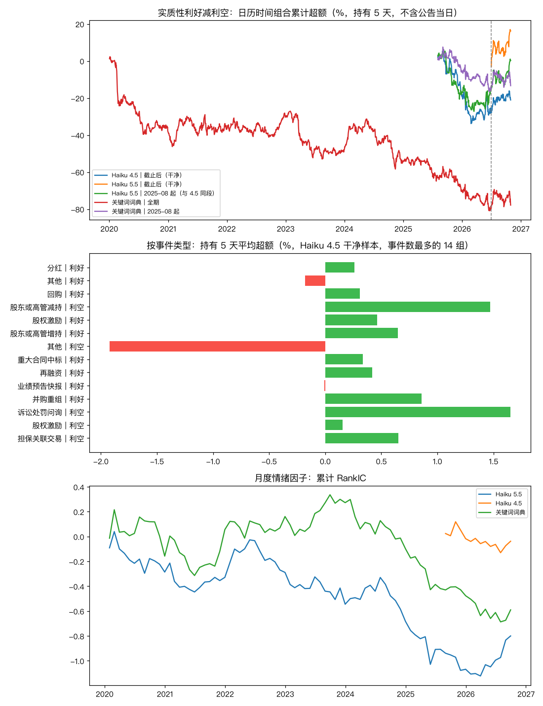

# 公告因子：大模型读公告标题（2026-11-11）

> 研究记录，不是投资建议；历史回测不代表未来收益。作者不是持牌金融顾问。

## 一句话结论

- 主假设（运行前写死、只有一个）：Haiku 4.5 在训练数据截止之后的干净样本里，实质性利好减利空、持有 5 天的超额收益 -0.35%，t = -0.96，门槛 t ≥ 2 → **未通过**。
- 大模型自身的前视：在 2025-08 至 2026-06（Haiku 5.5 的训练数据已覆盖、Haiku 4.5 没有），同一批公告上 Haiku 5.5 的多空收益比 Haiku 4.5 高 0.36%（t = 0.93）。
- 月度情绪因子：Haiku 5.5 RankIC -0.010（t -1.27），干净段 0.065（3 个月）→ **不显著**；Haiku 4.5 RankIC -0.003（t -0.19），干净段 -0.003（14 个月）→ **不显著**；关键词词典 RankIC -0.007（t -0.85），干净段 -0.012（14 个月）→ **不显著**。
- 总花费 $7.65（预算 $20）。

## 解读

1. **公告当天有反应，之后没有可交易的超额。** 含公告当日（参考口径）时，Haiku 5.5 截止前样本的 5 日多空 0.87%（t 6.17）；从公告日收盘之后算，多空 -0.23%（t -1.83）。信息在当天基本就被价格吸收了，只看标题、收盘后才行动的做法赚不到。
2. **20 天上反而有反转迹象，但不是预先登记的假设。** Haiku 5.5 截止前样本 20 日多空 -1.05%（t -3.27），词典全期 -0.77%（t -2.51）：利空公告之后的股票反而跑赢。前者所在样本可能有模型前视，后者没到 t ≥ 3，只能当作后续研究的线索。
3. **大模型比词典标得更接近强模型，但没有因此更能预测收益。** 对 Opus 5.5 复核的方向 kappa：Haiku 5.5 0.80，词典 0.58；可两者在公告日之后的多空都不显著，大模型在这里多带来的是“分类更准”，不是“收益更高”。
4. **没测到大模型的前视增益。** 同一段、同一批公告，见过这段数据的 Haiku 5.5 比没见过的 Haiku 4.5 多空高 0.36%（t 0.93），含公告当日高 0.35%（t 1.04），都不显著。可能的原因是输入只有去名的短标题，模型难以对上具体公司和日期。
5. **有方向的标注本身分歧不小**：总体方向一致率看着很高，主要因为大多数公告是中性；只看至少一方判为有方向的条目，模型之间的一致率明显更低（见“标注”一节）。

## 数据

- 公告：巨潮资讯（akshare `stock_zh_a_disclosure_report_cninfo`），今天的沪深300 成分股 300 只，2020-01 至 2026-10，共 273,770 条。只存标题、链接和哈希，原文不入库。
- 行情：新浪后复权日线（与因子检验同一份缓存，截至 2026-10-30）；基准为沪深300 指数。
- 股票池是**今天**的成分股，有幸存者偏差（见 `reports/因子检验-2026-11-10.md` 的说明）。

## 标注

- 输入只有**去掉公司名的标题**（简称、全称替换为“本公司”），不给日期、代码和任何之后的信息，减少模型凭记忆认出公司。
- 输出用 JSON Schema 约束：事件类型（16 类）、方向（利好 / 中性 / 利空）、强度 0–3、是否实质性。每个请求 50 条，Batch API（五折），按公告编号缓存，批次状态落盘可续跑。
- 模型：Haiku 5.5 标注全部公告（关闭思考、effort = low）；Haiku 4.5 只标注其训练数据截止之后（2025-08 起）的公告。
- 基线：关键词词典（`quant/llm_events/dictionary.py`，规则在看结果前固定）。

**一致率**（方向 / 是否实质 / 类型）：

- Haiku 5.5 对 Haiku 4.5（同段全部）：50,829 条，方向 93.6%（kappa 0.61；至少一方判为有方向的 6,213 条里一致 47.4%），实质 82.9%，类型 77.9%
- Haiku 5.5 对 Opus 5.5 复核：200 条，方向 96.0%（kappa 0.80；至少一方判为有方向的 26 条里一致 69.2%），实质 88.5%，类型 82.0%
- Haiku 4.5 对 Opus 5.5 复核：200 条，方向 95.0%（kappa 0.75；至少一方判为有方向的 27 条里一致 63.0%），实质 85.0%，类型 83.0%
- 词典 对 Opus 5.5 复核：200 条，方向 91.0%（kappa 0.58；至少一方判为有方向的 32 条里一致 43.8%），实质 80.0%，类型 —

复核用的是更强的模型（Opus 5.5），不是人工；从两个 Haiku 都标过的干净段里简单随机抽 200 条，随机种子运行前固定。

## 判定标准（运行前写进 `quant/llm_events/study.py`，提交 6f41b00）

- 事件日 t0 = 公告日当天或之后第一个交易日。巨潮日期只到日，所以主口径**不含 t0 当天**，从 t0 收盘开始算；含当天的数字只作参考。
- 日历时间组合：每天对正处在持有期内的事件按组求平均超额收益，多空 = 实质性利好 − 实质性利空；t 值用 Newey-West（滞后 = 持有天数），处理窗口重叠。
- 主假设一个，门槛 t ≥ 2；其余都是次要检验，门槛 t ≥ 3。
- 月度因子：全期 RankIC t ≥ 3 且干净段同号才算显著。



## 事件研究（多空 = 实质性利好 − 实质性利空，日历时间组合）

| 来源 | 样本段 | 持有天数 | 利好事件 | 利空事件 | 多空累计超额 | t | 利好组 | 利空组 | 含公告当日（参考） |
|---|---|---:|---:|---:|---:|---:|---:|---:|---:|
| Haiku 4.5 | 截止后（干净） | 1 | 3,842 | 747 | -0.03% | -0.19 | 0.06% | 0.08% |  |
| Haiku 4.5 | 截止后（干净） | 5 | 3,842 | 747 | -0.35% | -0.96 | 0.17% | 0.52% | 0.47%（t 1.36） |
| Haiku 4.5 | 截止后（干净） | 20 | 3,842 | 747 | -1.04% | -1.28 | 0.54% | 1.58% |  |
| Haiku 5.5 | 截止前 | 1 | 13,573 | 4,810 | 0.11% | 1.71 | 0.09% | -0.01% |  |
| Haiku 5.5 | 截止前 | 5 | 13,573 | 4,810 | -0.23% | -1.83 | 0.21% | 0.43% | 0.87%（t 6.17） |
| Haiku 5.5 | 截止前 | 20 | 13,573 | 4,810 | -1.05% | -3.27 | 0.81% | 1.87% |  |
| Haiku 5.5 | 截止后（干净） | 1 | 913 | 143 | 0.37% | 0.94 | 0.10% | -0.23% |  |
| Haiku 5.5 | 截止后（干净） | 5 | 913 | 143 | 1.00% | 1.18 | 0.42% | -0.58% | 1.69%（t 1.52） |
| Haiku 5.5 | 截止后（干净） | 20 | 913 | 143 | 3.74% | 1.59 | 3.06% | -0.68% |  |
| Haiku 5.5 | 2025-08 起（与 4.5 同段） | 1 | 2,968 | 689 | 0.14% | 0.70 | 0.12% | 0.01% |  |
| Haiku 5.5 | 2025-08 起（与 4.5 同段） | 5 | 2,968 | 689 | 0.00% | 0.01 | 0.18% | 0.18% | 0.80%（t 2.01） |
| Haiku 5.5 | 2025-08 起（与 4.5 同段） | 20 | 2,968 | 689 | -0.62% | -0.63 | 0.79% | 1.41% |  |
| 关键词词典 | 全期 | 1 | 21,546 | 8,293 | 0.01% | 0.17 | 0.07% | 0.06% |  |
| 关键词词典 | 全期 | 5 | 21,546 | 8,293 | -0.24% | -1.98 | 0.27% | 0.50% | 0.30%（t 2.43） |
| 关键词词典 | 全期 | 20 | 21,546 | 8,293 | -0.77% | -2.51 | 0.95% | 1.72% |  |
| 关键词词典 | 2025-08 起 | 1 | 4,717 | 1,058 | 0.00% | 0.02 | 0.06% | 0.07% |  |
| 关键词词典 | 2025-08 起 | 5 | 4,717 | 1,058 | -0.22% | -0.81 | 0.10% | 0.32% | 0.17%（t 0.58） |
| 关键词词典 | 2025-08 起 | 20 | 4,717 | 1,058 | -0.55% | -0.63 | 0.42% | 0.97% |  |
| 关键词词典 | 2026-07 起 | 1 | 1,453 | 251 | 0.13% | 0.43 | 0.12% | -0.00% |  |
| 关键词词典 | 2026-07 起 | 5 | 1,453 | 251 | 0.02% | 0.03 | 0.35% | 0.34% | 0.15%（t 0.20） |
| 关键词词典 | 2026-07 起 | 20 | 1,453 | 251 | 2.72% | 1.49 | 2.19% | -0.54% |  |

## 大模型的前视偏差

同一段（2025-08-01 至 2026-06-30）、同一批公告、同样的持有 5 天口径：

- Haiku 5.5（训练数据覆盖这段）：多空 -0.32%，t -0.76
- Haiku 4.5（训练数据不覆盖）：多空 -0.73%，t -1.58
- 差额 0.36%，同日配对 t 0.93，222 个交易日。

含公告当日（参考口径；如果模型记得哪些公告当天大涨大跌，差额最可能出现在这里）：

- Haiku 5.5：0.57%（t 1.51）；Haiku 4.5：0.21%（t 0.53）
- 差额 0.35%，同日配对 t 1.04。

解读：如果模型“记得”后来的股价，它在见过的时段会显得更准，差额为正。差额不显著并不证明没有前视，只说明在标题这种短输入、去掉公司名之后，没测到明显的前视增益。

## 按事件类型（Haiku 4.5 干净样本，持有 5 天，不含公告当日）

| 类型｜方向 | 事件数 | 平均超额 | t |
|---|---:|---:|---:|
| 分红｜利好 | 1,312 | 0.26% | 1.15 |
| 其他｜利好 | 878 | -0.18% | -0.54 |
| 回购｜利好 | 621 | 0.31% | 0.80 |
| 股东或高管减持｜利空 | 377 | 1.47% | 2.86 |
| 股权激励｜利好 | 303 | 0.46% | 0.65 |
| 股东或高管增持｜利好 | 241 | 0.65% | 1.42 |
| 其他｜利空 | 183 | -1.92% | -3.51 |
| 重大合同中标｜利好 | 147 | 0.33% | 0.58 |
| 再融资｜利好 | 136 | 0.42% | 0.52 |
| 业绩预告快报｜利好 | 86 | -0.01% | -0.01 |
| 并购重组｜利好 | 64 | 0.86% | 0.89 |
| 诉讼处罚问询｜利空 | 39 | 1.65% | 1.29 |
| 股权激励｜利空 | 31 | 0.15% | 0.14 |
| 担保关联交易｜利空 | 30 | 0.65% | 0.65 |
| 定期报告｜利空 | 29 | -1.55% | -1.34 |
| 业绩预告快报｜利空 | 22 | 1.77% | 1.14 |
| 担保关联交易｜利好 | 21 | 1.40% | 1.09 |
| 股东或高管减持｜利好 | 14 | -0.25% | -0.23 |
| 人事变动｜利空 | 11 | 0.23% | 0.15 |
| 分红｜利空 | 11 | 0.73% | 0.89 |

按类型拆开是很多个检验，门槛 t ≥ 3。

## 月度情绪因子

| 来源 | RankIC | t | 月数 | 干净段 RankIC | 干净段 t | 干净段月数 | 多空扣成本年化 | 非零覆盖率 | 判定 |
|---|---:|---:|---:|---:|---:|---:|---:|---:|---|
| Haiku 5.5 | -0.010 | -1.27 | 81 | 0.065 | 1.73 | 3 | -5.8% | 41% | **不显著** |
| Haiku 4.5 | -0.003 | -0.19 | 14 | -0.003 | -0.19 | 14 | 7.4% | 10% | **不显著** |
| 关键词词典 | -0.007 | -0.85 | 81 | -0.012 | -0.86 | 14 | -3.9% | 54% | **不显著** |

因子值是当月实质性公告的 方向×强度 之和，大部分股票大部分月份为 0，分组里有大量并列，结果噪声较大。

## 局限

- **只用了标题**：业绩预告、快报的标题多数不写增减，模型只能判为中性；拿到摘要或正文会更有信息量，但要逐篇下载 PDF，本次没做。
- **公告时间只到日**：主口径放弃了公告当天的反应，低估了可交易的部分，但避免了用到未来信息。
- **干净样本短**：Haiku 4.5 截止后约 15 个月，Haiku 5.5 截止后只有约 4 个月；月度因子在干净段上的检验力很弱。
- **幸存者偏差**：股票池是今天的沪深300 成分股。
- **Haiku 4.5 是旧模型**，官方承诺的最早退役日已过，之后可能无法复现这一部分标注。
- 复核用的是更强的模型，不是人工标注。

## 复现

```bash
PYTHONPATH=. .venv/bin/python -m quant.llm_events.data
PYTHONPATH=. .venv/bin/python -m quant.llm_events.label --model claude-haiku-5-5
PYTHONPATH=. .venv/bin/python -m quant.llm_events.label --model claude-haiku-4-5 --start 2025-08-01
PYTHONPATH=. .venv/bin/python -m quant.llm_events.label --review 200
PYTHONPATH=. .venv/bin/python -m quant.llm_events.run
```

需要 `ANTHROPIC_API_KEY`。运行编号 `20261111T140405_3ac28aa`；所有检验记在 `research/trials.csv`（phase = 公告因子）。
