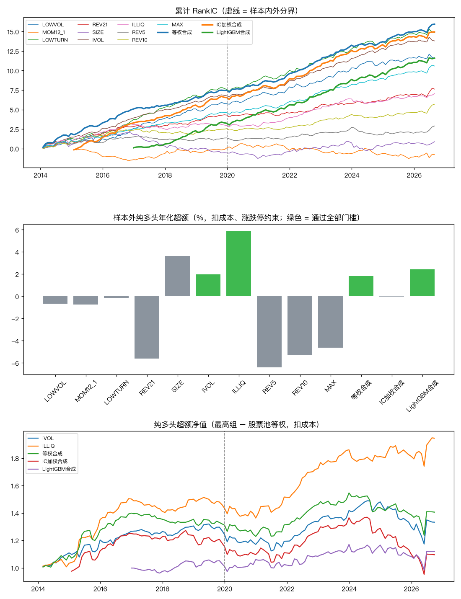

# 全 A 股因子挖掘（2026-11-11）

> 研究记录，不是投资建议；历史回测不代表未来收益。作者不是持牌金融顾问。

## 一句话结论

- 按运行前写死的门槛（`quant/alpha/spec.py`，提交 db2d90b；周线版偏离登记 2f54c55），**试了 13 个（10 个单因子 + 3 个合成），通过 4 个**：IVOL、ILLIQ、等权合成、LightGBM合成。
- LightGBM 合成相对线性合成的样本外 RankIC 差：对等权合成 -0.001（t -0.13，80 个月）；对IC加权合成 -0.001（t -0.11，80 个月）。
- 补充（不是门槛）：通缩夏普最高为 ILLIQ 的 0.50，全部低于 0.95。按 13 次试验折扣后，纯多头超额都不能确认显著。
- RankIC 显著（t ≥ 3）的有 10 个，但其中只有 4 个样本外纯多头超额为正。排序能力主要体现在避开最差的一组；做多最高组时，换手成本和涨停买不进会把优势吃掉。

## 偏离预先登记（改用周线）

- 原因：baostock 日线每只股票要 15–20 秒，5,481 只约 28 小时；为当天出结果改用周线（每只约 2.4 秒）。偏离在下载周线之前登记（提交 2f54c55）。
- 去掉 EP、BP：周线没有市盈率、市净率。12 个因子变为 10 个，试验次数 15 → 13，通过门槛仍为 t ≥ 3。
- 不能剔除 ST：周线没有 ST 标记；ST 股多为小市值，大部分已被“剔除流通市值最小 30%”去掉，残留的 ST 会让小市值、反转类因子的结果略有偏差。
- 调仓日为每个月最后一个不晚于月末的周五所在周；各因子改用周线窗口（见下表定义）。
- 涨跌停近似：最后一周涨幅 ≥ 涨停幅度的不新买、跌幅 ≥ 跌停幅度的持仓不卖，比真实规则更严（会多剔除一些股票）。
- 日线版代码和预先登记仍在（`quant/alpha/run.py`），数据下完后可以按原方案重跑、与本报告对照。

## 股票池与数据

- baostock 每个月末当天全部在市的 A股（**含之后退市的股票**，没有幸存者偏差），2014-01 至 2026-09，共 5,481 只出现过。
- 每月剔除上市不满一年、调仓周停牌或无成交、流通市值最小的 30%；剩下的股票每月 1,445–3,589 只（中位数 2,507）。
- 周收益用 baostock 周线涨跌幅（已按除权除息调整，抽查 3 只送转股确认），流通市值 = 周成交额 ÷ 周换手率。持有期内退市的股票，退市后收益记 0（按最后成交价拿回现金，略偏乐观）。
- 沪深300 那轮的股息率因子需要逐只下载分红数据，本轮没做，预先登记时已写明。

## 判定标准（运行前写死）

- 样本内到 2019 年底，样本外 2020 年起。
- 通过 = 同时满足：(a) 全期 RankIC t ≥ 3（13 个试验，按多重检验的更高门槛）；(b) 样本外 RankIC 均值 > 0；(c) 样本外纯多头超额（扣成本、含涨跌停约束）年化 > 0。
- 纯多头 = 最高五分之一组等权，月度调仓；最后一周涨幅达到涨停幅度的不新买，跌幅达到跌停幅度或停牌的持仓卖不出、留到下月；成本按往返 0.25% + 印花税（2023-08-28 前后分别计）。超额相对股票池等权。
- 多空 = 最高组 − 最低组，空头腿不扣融券成本，只作参考（A股个人难以融券）。
- 通缩夏普（DSR）按 13 次试验折扣，作为补充，不是门槛。



## 结果总表

| 名称 | 定义 | 全期 RankIC | t | 样本内 RankIC | 样本外 RankIC | 样本外年化 ICIR | 样本外纯多头超额（年化） | 样本外超额最大回撤 | 样本外多空（参考） | 月均单边换手 | DSR | 结果 |
|---|---|---:|---:|---:|---:|---:|---:|---:|---:|---:|---:|---|
| LOWVOL | 低波动 = -过去 52 周周收益标准差（至少 26 周） | 0.076 | 5.03 | 0.080 | 0.073 | 1.24 | -0.7% | -33.4% | 1.0% | 10% | 0.00 | **未通过** |
| MOM12_1 | 12-1 动量 = 第 t-11 到 t-1 个月的累计收益（由周收益复利得到，跳过最近一个月） | -0.005 | -0.42 | 0.001 | -0.011 | -0.21 | -0.7% | -22.1% | 3.5% | 24% | 0.00 | **未通过** |
| LOWTURN | 低换手 = -过去 4 周平均周换手率 | 0.098 | 6.72 | 0.105 | 0.091 | 1.58 | -0.2% | -28.4% | 5.6% | 24% | 0.01 | **未通过** |
| REV21 | 1 个月反转 = -过去 4 周累计收益 | 0.050 | 4.32 | 0.060 | 0.042 | 0.97 | -5.6% | -33.6% | -6.6% | 74% | 0.00 | **未通过** |
| SIZE | 小市值 = -log(流通市值)，流通市值 = 最后一周成交额 / 周换手率 | 0.006 | 0.44 | -0.008 | 0.018 | 0.39 | 3.6% | -10.9% | 5.6% | 22% | 0.20 | **未通过** |
| IVOL | 低特质波动 = -过去 12 周对市场（全部 A股等权）回归残差的标准差（至少 8 周） | 0.091 | 8.05 | 0.094 | 0.088 | 1.86 | 2.0% | -21.2% | 7.0% | 33% | 0.03 | **通过** |
| ILLIQ | 非流动性 = log(过去 4 周 |周收益| / 周成交额 的均值) | 0.046 | 4.37 | 0.041 | 0.051 | 1.34 | 5.9% | -7.9% | 12.3% | 38% | 0.50 | **通过** |
| REV5 | 1 周反转 = -最后一周收益 | 0.019 | 2.00 | 0.019 | 0.019 | 0.53 | -6.4% | -31.5% | -3.9% | 74% | 0.00 | **未通过** |
| REV10 | 2 周反转 = -过去 2 周累计收益 | 0.037 | 3.65 | 0.036 | 0.039 | 1.04 | -5.3% | -32.1% | -2.8% | 74% | 0.00 | **未通过** |
| MAX | 低彩票性 = -过去 4 周最大周收益 | 0.070 | 6.48 | 0.064 | 0.075 | 1.77 | -4.6% | -34.0% | -2.5% | 72% | 0.00 | **未通过** |
| 等权合成 | 10 个因子标准化值的平均 | 0.105 | 9.02 | 0.104 | 0.106 | 2.39 | 1.8% | -20.0% | 7.9% | 55% | 0.06 | **通过** |
| IC加权合成 | 权重 = max(过去 24 个月 RankIC 均值, 0) | 0.107 | 7.85 | 0.109 | 0.105 | 2.00 | -0.0% | -30.4% | 5.0% | 38% | 0.01 | **未通过** |
| LightGBM合成 | 每年 12 月用过去 60 个月重训，参数固定 | 0.099 | 7.03 | 0.088 | 0.104 | 2.19 | 2.4% | -15.9% | 11.5% | 44% | 0.02 | **通过** |

全期纯多头超额（含样本内）：LOWVOL -0.1%；MOM12_1 -0.5%；LOWTURN 0.7%；REV21 -3.4%；SIZE 4.1%；IVOL 2.6%；ILLIQ 6.1%；REV5 -5.4%；REV10 -4.2%；MAX -3.9%；等权合成 3.1%；IC加权合成 0.9%；LightGBM合成 1.3%。

## 局限

- 没有剔除北交所以外的其他特殊情况（如退市整理期）；流通市值是用成交量和换手率反推的，换手率为 0 的日子沿用之前的值。
- 涨跌停按周涨跌幅近似，不是逐日判断；成本没有区分大小盘的冲击成本，小盘股的真实成本可能更高。
- 合成和机器学习都只用这 10 个因子作为输入，没有加入行业、市值中性化；结论不代表更复杂的模型做不出来。
- 样本外从 2020 年开始，约 6 年，包括 2024 年初的小盘股崩盘。

## 复现

```bash
PYTHONPATH=. .venv/bin/python -m quant.alpha.data  # 只用于生成股票名单（中途可停）
PYTHONPATH=. .venv/bin/python -m quant.alpha.weekly_data
PYTHONPATH=. .venv/bin/python -m quant.alpha.weekly
```

运行编号 `20261111T195217_6aa2af5`；每个检验记在 `research/trials.csv`（phase = 因子挖掘）。
