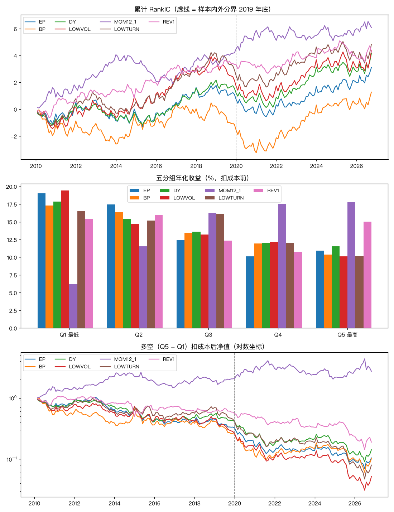

# A股单因子检验（2026-11-10）

> 研究记录，不是投资建议；作者不是持牌金融顾问。

## 先说局限：幸存者偏差

- 股票池是**今天**的沪深300 成分股，回看到 2010 年。历史成分股的免费来源（baostock）检验期间不可用，所以退而求其次。
- 这意味着样本里只有“活到今天、并且今天够大能进指数”的公司；当年进过指数、后来跌出去或退市的公司都不在里面。
- 偏差方向：过去涨得好的公司更可能留到今天，所以**动量**会被高估、**反转**会被低估；今天的大公司过去多半走势平稳，**低波**也可能被高估。估值类（EP、BP、股息率）偏差方向不确定。
- 早年股票池更小（很多今天的成分股那时还没上市），早期结果的噪声更大。
- 所以下面的结论只能当作“在幸存者里成立与否”。数据源恢复后应换成历史成分重跑（`--source history`），代码不用改。

## 数据与方法

- 股票池：今天的沪深300 成分股（回看到 2010 年；有幸存者偏差），共 300 只；每个月末再剔除当天停牌的（月末最后一个交易日没有成交）。
- 区间：2010-01 至 2026-10，月频；样本内到 2019 年底，样本外 2020 年起。
- 数据（全部免费，可复现）：members：akshare index_stock_cons_csindex；daily：新浪 后复权日线；valuation：百度 PE TTM / PB（约 22 天一个点）；raw_m：新浪 不复权日线取月末；div：akshare stock_history_dividend_detail。
- 每个月末 t 只用 t 及以前的数据算因子，和 t 到 t+1 月末的后复权收益比较。截面先 1%/99% 缩尾再标准化，RankIC 用 Spearman 相关。
- 五分组：每月按因子值等分 5 组，组内等权，持有一个月。多空 = Q5 - Q1；多头超额 = Q5 - 股票池等权。
- 成本：每单位单边换手按往返 0.25% + 印花税（2023-08-28 前 0.1%，之后 0.05%）扣除。

- 估值数据（百度）大约每 22 天一个点，月末用最近一个点，最多滞后约 3 周；这个口径偏保守，不会用到未来数据，但不确定百度是否按“财报公告日”而非“报告期”切换盈利数据，如果是后者会有轻微前视。
- 取不到历史 ST 标记，所以没有剔除 ST（今天的成分股里没有 ST，但不代表历史上没有）。

## 运行后的修正（如实记录）

- 第一次运行没有剔除上市不满一年的股票。检查极端值时发现，月收益最大的几个都是新股上市后的连续一字涨停（最高一个月 +456%），这部分涨幅实际买不到，于是加了“上市满 252 个交易日”的条件后重跑（`calc.MIN_AGE`）。
- 修正前的结果（`research/factor_results-修正前含次新股.json`，trials.csv 里也有）：EP t 0.92；BP t 0.44；DY t 1.47；LOWVOL t 1.16；MOM12_1 t 1.87；LOWTURN t 1.75；REV1 t 1.40；判定全部为不显著，和修正后一致。
- 判定标准、因子定义、样本切分都没有改。

## 判定标准（运行前写进代码，`quant/factors/evaluate.py`）

- **显著**：全期 RankIC 均值的 t 值 ≥ 3（7 个因子同时检验，按多重检验的更高门槛），且样本外与全期同号；
- **弱**：2 ≤ t < 3 且样本外同号；**方向相反**：t ≤ -2；其余为**不显著**。

## 结果总表

| 因子 | 定义 | RankIC 均值 | t 值 | 年化 ICIR | IC>0 月份占比 | 样本内 RankIC | 样本外 RankIC | 判定 |
|---|---|---|---|---|---|---|---|---|
| EP | 盈利收益率 = 1 / 市盈率TTM（亏损股为负值，保留） | 0.015 | 0.86 | 0.21 | 54% | 0.006（t 0.3） | 0.029（t 1.0） | **不显著** |
| BP | 账面市值比 = 1 / 市净率（净资产为负的剔除） | 0.006 | 0.32 | 0.08 | 50% | -0.013（t -0.5） | 0.035（t 1.1） | **不显著** |
| DY | 股息率 = 近 12 个月已实施现金分红（税前，每股）/ 月末不复权收盘价 | 0.021 | 1.27 | 0.31 | 52% | 0.010（t 0.5） | 0.036（t 1.2） | **不显著** |
| LOWVOL | 低波动 = -过去 252 个交易日日收益标准差（至少 120 个有效交易日） | 0.022 | 1.04 | 0.26 | 53% | 0.014（t 0.6） | 0.033（t 0.9） | **不显著** |
| MOM12_1 | 12-1 动量 = t-1 月末 / t-12 月末 后复权收盘 - 1（跳过最近一个月） | 0.030 | 1.88 | 0.46 | 53% | 0.038（t 1.9） | 0.019（t 0.7） | **不显著** |
| LOWTURN | 低换手 = -过去 20 个交易日平均换手率 | 0.024 | 1.34 | 0.33 | 53% | 0.021（t 1.0） | 0.029（t 0.9） | **不显著** |
| REV1 | 1 个月反转 = -(当月收益) | 0.021 | 1.47 | 0.36 | 48% | 0.028（t 1.6） | 0.012（t 0.5） | **不显著** |



## 五分组与多空（年化）

| 因子 | Q1 | Q2 | Q3 | Q4 | Q5 | 多空 扣成本前 | 多空 扣成本后 | 样本外多空 扣成本后 | Q5 超额 扣成本后 | 样本外 Q5 超额 扣成本后 | Q5 月均单边换手 |
|---|---|---|---|---|---|---|---|---|---|---|---|
| EP | 19.0% | 17.4% | 12.5% | 10.1% | 10.9% | -11.9% | -12.6% | -13.7% | -4.7% | -5.5% | 8% |
| BP | 17.3% | 16.4% | 13.4% | 11.9% | 10.4% | -12.2% | -12.8% | -11.0% | -5.2% | -4.5% | 7% |
| DY | 17.9% | 15.4% | 13.6% | 12.0% | 11.6% | -10.0% | -11.0% | -12.9% | -4.4% | -4.6% | 11% |
| LOWVOL | 19.4% | 14.7% | 13.2% | 12.2% | 10.1% | -15.6% | -16.2% | -19.6% | -5.9% | -6.2% | 8% |
| MOM12_1 | 6.2% | 11.6% | 16.2% | 17.6% | 17.8% | 8.5% | 6.2% | 2.6% | 2.4% | 0.8% | 24% |
| LOWTURN | 16.5% | 15.2% | 16.1% | 12.0% | 10.2% | -12.5% | -14.0% | -19.5% | -6.1% | -6.1% | 17% |
| REV1 | 15.4% | 16.0% | 12.4% | 10.7% | 15.0% | -3.4% | -9.4% | -14.3% | -2.5% | -3.8% | 81% |

注：A股个人投资者不能方便地融券做空，多空只是衡量因子区分度的尺子；能实际做的是只买 Q5，对应“Q5 超额”。

### 为什么 RankIC 为正，分组均值却是 Q1 更高

RankIC 看的是排序（多数股票），分组收益看的是等权均值（会被少数大涨的股票拉高）。下表是每月组内**中位数**收益的平均值：

| 因子 | Q1 | Q2 | Q3 | Q4 | Q5 | Q5 - Q1 |
|---|---|---|---|---|---|---|
| EP | -0.07% | 0.24% | -0.20% | 0.14% | 0.46% | 0.53% |
| BP | 0.13% | 0.11% | -0.11% | -0.04% | 0.26% | 0.12% |
| DY | -0.21% | 0.02% | 0.00% | 0.11% | 0.42% | 0.63% |
| LOWVOL | -0.20% | 0.01% | 0.12% | 0.07% | 0.35% | 0.55% |
| MOM12_1 | -0.41% | 0.06% | 0.25% | 0.35% | 0.24% | 0.65% |
| LOWTURN | -0.37% | 0.03% | 0.28% | 0.28% | 0.23% | 0.60% |
| REV1 | -0.09% | 0.30% | 0.09% | -0.01% | 0.24% | 0.33% |

按中位数，多数因子是 Q5 好于 Q1，和 RankIC 的方向一致；按均值则反过来。也就是说，高估值、高波动、高换手的组多数股票表现更差，但组里偶尔有涨几倍的股票。用今天的成分股回看，这种右偏被幸存者偏差放大：当年估值高、波动大的小公司，正是后来涨上来才进了沪深300 的那批。

## 分年度 RankIC 均值

| 因子 | 2010 | 2011 | 2012 | 2013 | 2014 | 2015 | 2016 | 2017 | 2018 | 2019 | 2020 | 2021 | 2022 | 2023 | 2024 | 2025 | 2026 | 为正的年份 |
|---|---|---|---|---|---|---|---|---|---|---|---|---|---|---|---|---|---|---|
| EP | -0.029 | 0.072 | 0.014 | -0.129 | 0.044 | 0.005 | 0.067 | 0.091 | 0.013 | -0.087 | -0.088 | 0.055 | 0.003 | 0.110 | 0.005 | 0.020 | 0.125 | 13/17 |
| BP | -0.097 | 0.025 | -0.016 | -0.128 | 0.142 | 0.010 | 0.098 | -0.031 | 0.013 | -0.147 | -0.140 | 0.094 | 0.045 | 0.158 | 0.010 | -0.006 | 0.102 | 10/17 |
| DY | -0.059 | 0.090 | -0.003 | -0.093 | 0.027 | 0.002 | 0.072 | 0.096 | 0.049 | -0.081 | -0.054 | 0.029 | 0.045 | 0.142 | -0.002 | -0.027 | 0.149 | 10/17 |
| LOWVOL | -0.069 | 0.084 | 0.023 | -0.090 | 0.107 | 0.039 | 0.114 | 0.049 | 0.053 | -0.168 | -0.056 | 0.058 | 0.006 | 0.156 | -0.010 | -0.042 | 0.143 | 11/17 |
| MOM12_1 | 0.075 | 0.059 | 0.062 | 0.143 | -0.055 | -0.110 | 0.020 | 0.109 | -0.000 | 0.073 | 0.115 | -0.063 | 0.022 | 0.009 | 0.001 | 0.040 | 0.009 | 13/17 |
| LOWTURN | -0.063 | 0.128 | 0.022 | -0.112 | 0.070 | 0.041 | 0.108 | 0.061 | 0.091 | -0.138 | -0.033 | 0.052 | 0.052 | 0.107 | -0.017 | -0.052 | 0.114 | 11/17 |
| REV1 | 0.028 | 0.017 | 0.064 | 0.006 | 0.015 | 0.034 | 0.090 | -0.017 | 0.027 | 0.013 | -0.021 | 0.002 | 0.096 | -0.034 | 0.057 | -0.058 | 0.048 | 13/17 |

## 结论

- **不显著**：EP（RankIC 0.015，t 0.9，样本外 0.029）、BP（RankIC 0.006，t 0.3，样本外 0.035）、DY（RankIC 0.021，t 1.3，样本外 0.036）、LOWVOL（RankIC 0.022，t 1.0，样本外 0.033）、MOM12_1（RankIC 0.030，t 1.9，样本外 0.019）、LOWTURN（RankIC 0.024，t 1.3，样本外 0.029）、REV1（RankIC 0.021，t 1.5，样本外 0.012）。
- 通过判定且样本外 Q5 扣成本后仍有超额的：无。
- 以上都在幸存者偏差下得到，动量 / 低波的结果尤其要打折扣；换成历史成分重跑前，不据此做任何实盘决定。

## 复现

```bash
PYTHONPATH=. .venv/bin/python -m quant.factors.data_current
PYTHONPATH=. .venv/bin/python -m quant.factors.run --source current
```

运行编号 `20261110T173457_e367bde`；每个因子的结果记在 `research/trials.csv`（phase = 因子检验）。
